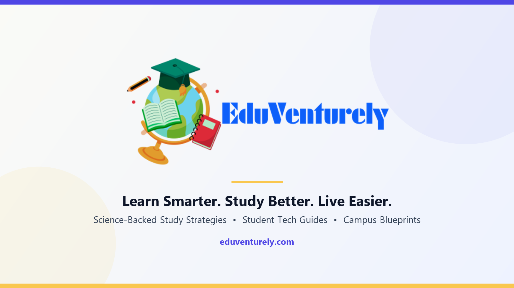

  

<h1 align="center">
  
  Eduventurely — Official Knowledge Hub & Category Directory
</h1>

  <strong>Science-backed study strategies, honest student tech reviews, and ergonomic campus blueprints.</strong> 
  <a href="https://eduventurely.com/">Official Website</a> ·
  <a href="https://eduventurely.com/start-here/">Start Here Hub</a> ·
  <a href="https://eduventurely.com/about/">About & Editorial Standards</a> ·
  <a href="https://eduventurely.com/blog/">Browse All Guides</a>

---

## Editorial Mission & E-E-A-T Standards

**[Eduventurely](https://eduventurely.com/)** is an independent educational resource hub built to help students, parents, and lifelong learners replace passive cramming and cluttered hardware lists with sustainable, cognitive-science-backed academic systems.

- **600+ Research-Backed Guides** across **13 core topic pillars**
- **0 Pay-to-Win or Sponsored Placements** — 100% editorial independence ([Affiliate Disclosure & Methodology](https://eduventurely.com/affiliate-disclosure/))
- **Domain Specialists:** Led by **AK Zilani** (Lead Hardware Benchmarker), **SAM Neaj** (Cognitive Strategy Editor), and the [Eduventurely Editorial Testing Desk](https://eduventurely.com/welcome-to-eduventurely-your-compass-for-a-future-ready-education/)

---

## Complete 13 Canonical Category Hubs

| # | Category Hub | Focus & Scope |
|---:|---|---|
| 1 | **[Tech for Students](https://eduventurely.com/category/tech-for-students/)** | Laptops, tablets, noise-canceling headphones & chargers tested for campus life. |
| 2 | **[Study Methods](https://eduventurely.com/category/study-methods/)** | Active recall, spaced repetition, SQ3R, and cognitive science strategies. |
| 3 | **[Dorm Essentials](https://eduventurely.com/category/college-life/college-dorm-essentials/)** | Mattress toppers, space-saving organizers, and campus room setups. |
| 4 | **[College Life](https://eduventurely.com/category/college-life/)** | Freshman advice, roommate survival, time management, and health. |
| 5 | **[Books & Audiobooks](https://eduventurely.com/category/books-subjects/)** | Audible savings, test prep guides (SAT, ACT), and book summaries. |
| 6 | **[Deals & Free Trials](https://eduventurely.com/category/student-deals-free-trials/)** | Verified software discounts, subscription savings, and budget hacks. |
| 7 | **[Online Learning](https://eduventurely.com/category/online-learning/)** | Digital note-taking apps, e-learning platforms, and productivity software. |
| 8 | **[Study Space & Desks](https://eduventurely.com/category/study-space/)** | Ergonomic chairs, monitor arms, desk lighting & posture essentials. |
| 9 | **[Study Supplies](https://eduventurely.com/category/study-supplies/)** | Paper planners, highlighters, notebook binders & stationery essentials. |
| 10 | **[Kids Learning](https://eduventurely.com/category/kids-learning/)** | STEM building kits, developmental toys, and interactive learning books. |
| 11 | **[Homeschool Hub](https://eduventurely.com/category/homeschool-hub/)** | Structured daily routines, accredited curriculum advice & home teaching. |
| 12 | **[Back to School](https://eduventurely.com/category/back-to-school/)** | Complete grade-by-grade checklists and budget shopping blueprints. |
| 13 | **[Student Gifts](https://eduventurely.com/category/student-gifts/)** | Graduation presents, tech stocking-stuffers & thoughtful academic gifts. |

---

## Core Navigation & Flagship Study Guides

### Navigation & Editorial Pages
- **[Start Here — Official Educational Navigation Hub](https://eduventurely.com/start-here/)**
- **[About Eduventurely — Mission, Story & Editorial Standards](https://eduventurely.com/about/)**
- **[Editorial Testing Desk & Manifesto](https://eduventurely.com/welcome-to-eduventurely-your-compass-for-a-future-ready-education/)**
- **[Browse All Articles](https://eduventurely.com/blog/)**
- **[Affiliate Disclosure & Testing Methodology](https://eduventurely.com/affiliate-disclosure/)**
- **[Contact Eduventurely](https://eduventurely.com/contact/)**

### Flagship Research-Backed Guides
- **[Active Recall Method: How to Use It for Better Grades](https://eduventurely.com/active-recall-method-how-to-use-it-for-better-grades/)**
- **[Spaced Repetition Study Schedule: Ultimate Guide](https://eduventurely.com/spaced-repetition-study-schedule-ultimate-guide/)**
- **[Pomodoro Technique for Students: Complete Guide](https://eduventurely.com/pomodoro-technique-for-students-complete-guide/)**
- **[Memory Techniques for Students: Proven Methods](https://eduventurely.com/memory-techniques-for-students-proven-methods/)**
- **[SQ3R Reading Method: How It Works for Heavy College Textbooks](https://eduventurely.com/sq3r-reading-method-how-it-works-for-textbooks/)**
- **[How to Write a Study Guide That Actually Helps You Retain](https://eduventurely.com/how-to-write-a-study-guide-that-actually-helps-you-retain/)**
- **[Best Laptops for College Students on a Budget (Tested & Rated)](https://eduventurely.com/best-laptops-for-college-students-on-a-budget-tested-rated/)**
- **[College Dorm Room Study Setup: The Complete Ergonomic Guide](https://eduventurely.com/dorm-room-study-setup-complete-guide/)**
- **[How to Get Audible Cheaper As a Student — Every Legitimate Method](https://eduventurely.com/how-to-get-audible-cheaper-as-a-student-every-legitimate-method/)**

---

## Official Brand Network

- **Website:** [https://eduventurely.com/](https://eduventurely.com/)
- **Google Sites Knowledge Hub:** [Eduventurely Knowledge Hub](https://sites.google.com/view/eduventurelyknowledgehub/home)
- **Medium:** [@eduventurely.com](https://medium.com/@eduventurely.com/beyond-rereading-how-active-recall-and-spaced-repetition-rewire-academic-retention-d671a3600d2a)
- **DEV Community:** [dev.to/eduventurely](https://dev.to/eduventurely) · [Attention Architecture for STEM Students](https://dev.to/eduventurely/attention-architecture-for-stem-students-designing-a-high-focus-study-workflow-17i6)
- **Hashnode:** [eduventurely.hashnode.dev](https://eduventurely.hashnode.dev/) · [@eduventurely](https://hashnode.com/@eduventurely)
- **Telegraph:** [The Ultimate Student Productivity & Study Gear Blueprint](https://telegra.ph/The-Ultimate-Student-Productivity--Study-Gear-Blueprint-11-10)
- **Wakelet:** [@eduventurely](https://wakelet.com/@eduventurely) · [Essential College Tech & Productivity Blueprints](https://wakelet.com/wake/TDdQh553k2DsEDxwJkd_d)
- **Product Hunt:** [producthunt.com/@eduventurely](https://www.producthunt.com/@eduventurely)
- **Buy Me a Coffee:** [buymeacoffee.com/eduventurely](https://buymeacoffee.com/eduventurely)
- **X (Twitter):** [@eduventurely](https://x.com/eduventurely)

---

Repository assets: [`assets/eduventurely-cover-banner.png`](assets/eduventurely-cover-banner.png) · [`assets/eduventurely-logo.png`](assets/eduventurely-logo.png) · Published by <a href="https://eduventurely.com/">Eduventurely</a>
